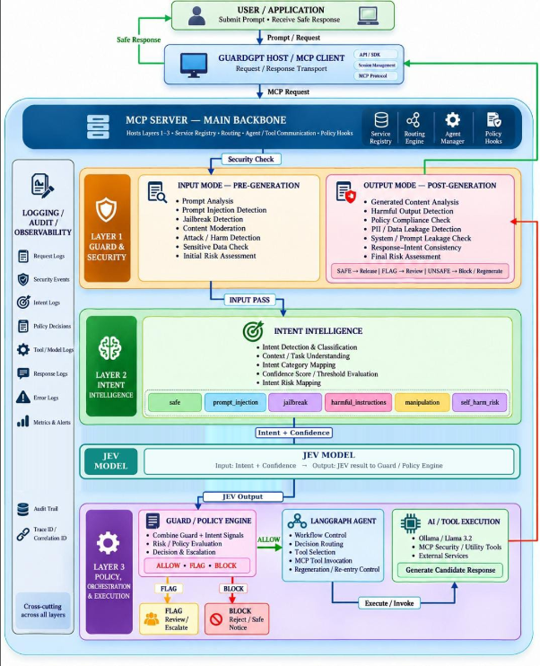

# GuardGPT

A local, layered safety guard for prompts and answers. Every request goes through
an MCP server that hosts the three guard layers, the JEV model and a LangGraph
agent. The agent runs its tools (Ollama / Llama 3.2, output review, redaction) on a
second MCP server, and one trace id follows the request through every stage.

## Architecture



Layers talk through typed contracts in `core/layers/contracts.py`
(`GuardVerdict`, `IntentResult`, `JEVResult`, `PolicyDecision`).

## Setup

The model weights (`*.pt`) are stored with [Git LFS](https://git-lfs.com). Run
`git lfs install` once before cloning, otherwise those files are only small text pointers.

```powershell
Set-ExecutionPolicy -Scope Process Bypass
.\setup.ps1
.\.venv\Scripts\Activate.ps1
```

On Linux/macOS: `bash setup.sh`. Python 3.11+ is recommended. Ollama must be
running with `llama3.2` pulled for answers (`--check` does not need it).

Runtime files expected in the project:

- `data/guardgpt_dataset.jsonl`, `data/guardgpt_faiss.index`, `data/guardgpt_id_map.json`
- `intent_classifier/best_model.pt`, `tokenizer.json`, `config.json`, `intent_anchors.json`
- `intent_classifier/topic_anchors.json`, `task_anchors.json` (topic and task examples)
- for the fine-tuned JEV: `intent_classifier/jev_finetuned/best_model.pt` (see below)

The fine-tuned JEV paths in `.env` are full paths. If you move or rename the project
folder, update them (see [Troubleshooting](#troubleshooting)).

The embedding model `all-MiniLM-L6-v2` is loaded from the HuggingFace cache,
or from a folder set in `GUARDGPT_EMBEDDING_MODEL`.

## Running

```bash
python main.py --chat                 # interactive, session-aware (/session for a report)
python main.py --prompt "..."         # one audited answer
python main.py --check --prompt "..." # input layers only, no Ollama
python main.py --pipeline             # demo: one prompt per intent label
python main.py --status               # data files, JEV config, Ollama models
python main.py --chat --verbose       # full layer line, distribution, reasons
python evaluate_intent.py             # per-label accuracy on tests/data/intent_samples.json
python evaluate_intent.py --prompt "..."
python evaluate_intent.py --json out.json   # also write a machine-readable report
python tests/test_cases/evaluate_ablation.py   # switch layers off one at a time and compare the decisions
python review_cli.py list             # review queue (with priority)
python review_cli.py escalated        # pending escalated reviews, most urgent first
python dashboard.py                   # optional live web monitor (see below)
python run_tests.py                   # full test suite
```

Each answer prints the reply on the `GuardGPT:` line, then a short summary:

```text
[ALLOW | SAFE]
Topic: coding | Safety: safe 84% | Decision: ALLOW
Trace: 1796c4f9
```

A supportive self-harm reply currently shows as `[BLOCK | SUPPORT]` with
`Decision: BLOCK`. The message was answered: `BLOCK` here means the normal answer path
was replaced by a support reply.

A chat session remembers the last 8 answered exchanges, so a request such as "summarise
this chat" covers only those. After changing `.env`, restart the chat and the dashboard;
running programs keep the old settings.

`--verbose` prints the full line instead, plus the intent distribution and reasons:
`L1 input: SAFE | Topic: coding 98% | Context: code, follow-up | Safety intent: safe 84.1% | JEV: ALLOW (risk low) [model: safe 99%] | Policy: ALLOW | L1 output: SAFE`.
Search the trace id in `logs/guardgpt_trace.jsonl` (the short id is a prefix).

**Topic, task and safety intent.** *Safety intent* is the six-label Layer 2 result that
drives allow/flag/block. *Topic* is what the message is about (greeting, coding,
cybersecurity, technology, education, math, health_wellbeing, emotional_support,
writing, summarization, daily_life, conversation, or `general`), from
`core/layers/topic_intent.py` and `intent_classifier/topic_anchors.json`. *Context*
(`core/layers/context_understanding.py`, `task_anchors.json`) adds the task (question,
how_to, creation, code, transformation, advice, chat, personal_support), whether the
message follows up on the previous turn, a topic change, and a session trend
(clean / watch / escalating). Topic and context are informational only and never change
a decision; add a line to the anchor files to fix a wrong label, no retraining needed.

### Web dashboard (optional)

A live monitor. Chat stays in the CLI; the dashboard shows what happens.

```powershell
# terminal 1:  chat
python main.py --chat

# terminal 2:  monitor
.\.venv\Scripts\Activate.ps1
python dashboard.py              # opens http://127.0.0.1:8080
python dashboard.py --no-browser # do not open a browser window
python dashboard.py --port 9000
```

Stop it with Ctrl+C. It starts no model and no MCP server (it opens in under a second)
and reads the same `logs/` folder as the CLI. New requests are pushed to the open page
within about a second, with a toast (and an optional desktop notification) for an urgent
escalation. Tabs:

| Tab | What it does |
|---|---|
| **Overview** | Counters, alerts (with Acknowledge), traffic-over-time chart (per hour or day) with latency, safety-intent and topic charts, recent requests, and a printable **summary report**. |
| **Requests** | Every request, with search, filters (decision, safety intent, topic, session), paging and CSV export. |
| **Sessions** | One row per chat session; click for the conversation as a timeline with the session risk. |
| **Reviews** | The review queue (FLAG outcomes, carried-risk blocks and explicit crisis cases), most urgent first, with the redacted prompt, age, priority filter, notes, bulk Approve / Reject and CSV export. |
| **Feedback** | Requests you marked correct or wrong; **Export anchor lines** turns the wrong ones into lines for `intent_anchors.json`. |
| **Evaluation** | Runs `evaluate_intent.py` as a background job and shows accuracy for the head, anchors, dataset, ensemble and JEV, a per-label table and a confusion matrix. Quick = rules only; Full = with the fine-tuned JEV (minutes). |
| **System** | Readiness, installed Ollama models, configuration, package versions, log files and sizes, and **Trim old logs** (never touches reviews, escalations, feedback or metrics, and refuses while a chat is writing). |
| **Traces** | All events of one request by trace id. |

The **Block** count on the Sessions tab includes supportive replies; open the session
timeline to see which turns were `SUPPORT`.

Click any request for the **detail panel**: the five pipeline stages, a table of what the
ensemble, head, anchors and dataset each predicted, a timing bar per stage, the findings and
reasons, and buttons to mark the safety intent correct or wrong. Handy extras: **Hide text**
blurs prompt text for demos, a theme switch, deep links (`#sessions`, `#request/<trace id>`)
and keyboard shortcuts (1-8 tabs, `/` search, `r` refresh, `Esc` close).

The header shows Ollama, intent model, JEV mode and data readiness. It listens on
127.0.0.1 only, every API call needs a per-run token embedded in the page, and it shows
the redacted prompt text from `logs/`, so treat it like the logs. Feedback stores only trace
ids and labels; the evaluation job and trimming write to `logs/` (`guardgpt_feedback.jsonl`,
`guardgpt_alerts_ack.json`, `guardgpt_eval.json`).

## The JEV model

`JEV_STYLE_MODE` picks the backend:

| Mode | What it does |
|---|---|
| `builtin` (default) | Rules over the Layer 2 label, confidence and Layer 1 findings. |
| `finetuned` | Runs your fine-tuned JEV checkpoint on the prompt, and combines its verdict with the Layer 2 intent + confidence. The builtin verdict is kept as a floor, so inside JEV the model can only make a verdict stricter (Layer 3 may still relax it). |
| `server` / `auto` | External Jev-Style HTTP server (`auto` falls back to builtin). |

The builtin rules also use the session: after two or more blocked turns in the last
three, a FLAG becomes a BLOCK, and a safe verdict is flagged only if one single unsafe
label reaches `JEV_FLAG_PEAK`. Supportive self-harm turns are not counted as blocked
turns here.

**Carried risk.** The chat also keeps one score that remembers earlier blocked turns,
so a few harmless messages do not wipe out an earlier attack:

```text
blocked turn:   score = max(turn risk, 0.9 * score)
any other turn: score = score * (0.85 + 0.15 * turn risk)
```

A safe turn lowers the score faster than a doubtful one. While the score is 0.50 or
more, a JEV FLAG becomes a BLOCK (reason `escalated_carried_risk`), in every JEV mode.
Such a block is still added to the review queue and does not raise the score again.
Self-harm turns leave the score unchanged and are never upgraded. The score starts at 0,
stays 0 in a chat with no blocked turn, and resets with `/new` or a new chat. It is shown
as `carried_risk` in the session report and the `jev` trace event. Set
`JEV_CARRY_ENABLED=0` for the old behaviour.

In `finetuned` mode the question and class descriptions come from the checkpoint itself
(`jev_adapter_guardgpt.py` reads them). The model was trained with that wording, so
change thresholds or rules rather than the wording unless you retrain.

### Using the fine-tuned checkpoint

The checkpoint (`intent_classifier/jev_finetuned/best_model.pt`, about 1.5 GB, a
Qwen3.5 0.8B model) needs the base model's config, tokenizer and readout files. Use the
Jev-Style base model (`chaoliangUNSW/Jev-Style-0.8B-Decision-v3` on Hugging Face); the
folder must contain `config.json`, `tokenizer.json`, `readout_config.json` and
`jev_style_decision.py`. Point GuardGPT at them in `.env`:

```ini
JEV_STYLE_MODE=finetuned
JEV_CHECKPOINT=C:/path/to/GuardGPT/intent_classifier/jev_finetuned/best_model.pt
JEV_BASE_MODEL_DIR=C:/Users/<you>/.cache/huggingface/hub/models--chaoliangUNSW--Jev-Style-0.8B-Decision-v3/snapshots/<hash>
JEV_ADAPTER=C:/path/to/GuardGPT/jev_adapter_guardgpt.py
JEV_DEVICE=cpu                              # or cuda
```

`jev_adapter_guardgpt.py` loads the checkpoint into the official Jev-Style engine and
asks the question and class descriptions stored in the checkpoint, so scoring matches
training (about 82% exact label and 96% safe-vs-unsafe on the project's evaluation
prompts). `jev_adapter_example.py` is the template if you train a different model.
On CPU, loading takes about 20 seconds and each prompt about 2 to 3 seconds.

If the checkpoint is missing or fails to load, requests are BLOCKED with
`final_status=ERROR` and reason `jev_failed`, and the error says what is
missing. It never falls back to "safe" silently. `python main.py --status`
shows the JEV configuration and any problems.

## Review and escalation

A FLAG goes to the review queue (`logs/guardgpt_review.jsonl`) with a priority:

| Priority | When |
|---|---|
| `urgent` | critical risk, or a self-harm signal |
| `high` | high risk, two or more flagged/blocked turns in the last four, or a risky session |
| `normal` | everything else |

`high` and `urgent` are escalated: written to `logs/guardgpt_escalations.jsonl`, counted
in the metrics (an urgent one raises the `urgent_escalation` alert) and listed first by
`python review_cli.py escalated`. The user is told whether the request was sent for
review or escalated to a human reviewer. Resolving a review (`review_cli.py resolve`, or
the dashboard) records the decision only; it never releases the withheld answer.

FLAG outcomes are queued, and so are two kinds of BLOCK: one caused only by carried risk,
and an explicit self-harm crisis. A crisis is queued as `urgent` and escalated (reason
`crisis_support`, stage `support`) so a person can follow up, while the supportive reply is
still shown at once. Other supportive self-harm replies are not queued. The queue only
helps if someone watches it, for example through the dashboard's `urgent_escalation` alert.

## Tools MCP server

The agent never calls Ollama directly. Its tools run on a second MCP server
(`mcp_server/tools_server.py`), called over the MCP protocol by `agent/tool_client.py`:

| Tool | Purpose |
|---|---|
| `redact_text` | Security tool: replaces PII and secrets before anything reaches the model |
| `ollama_generate`, `ollama_support` | Answer and crisis-support generation |
| `ollama_review` | Structured output review (the auditor) |

The response composer (refusals, notices) and the output auditor use the same tools.
The server starts on first use (loopback, free port) and exits when the main server
exits. It refuses calls without a per-launch secret token, because raw generation must
not be reachable without Layers 1-3. Tool calls pass an allowlist and size limits.

## Configuration

| Variable | Default | Purpose |
|---|---|---|
| `GUARDGPT_MCP_URL` | `http://127.0.0.1:8000/mcp` | MCP endpoint (auto-started by the CLI) |
| `GUARDGPT_TOOLS_URL`, `GUARDGPT_TOOLS_TOKEN` | auto | Tools MCP server (normally started and secured automatically) |
| `GUARDGPT_DASHBOARD_PORT` | `8080` | Dashboard port |
| `GUARDGPT_EMBEDDING_MODEL` | HF cache | Local MiniLM folder |
| `GUARDGPT_ALLOW_MODEL_DOWNLOAD` | off | Set to `1` to let the embedding model download |
| `GUARDGPT_L2_WEIGHTS` | `head=0.2,anchors=0.6,dataset=0.2` | Layer 2 ensemble weights |
| `GUARDGPT_LOG_DIR` | `logs/` | Log directory |
| `OLLAMA_URL` / `OLLAMA_MODEL` | `http://localhost:11434` / `llama3` (`.env.example` sets `http://127.0.0.1:11434` / `llama3.2`) | Generation |
| `GUARDGPT_DATASET` | `data/guardgpt_dataset.jsonl` | Dataset file |
| `GUARDGPT_INTENT_MODEL` | `intent_classifier/best_model.pt` | Trained intent head |
| `OLLAMA_AUDIT_MODEL` | generation model | Output reviewer model |
| `OLLAMA_TIMEOUT`, `OLLAMA_TEMPERATURE` | `120`, `0.2` | Generation limits |
| `JEV_STYLE_MODE` | `builtin` | `builtin`, `finetuned`, `server`, `auto` |
| `JEV_CHECKPOINT`, `JEV_BASE_MODEL_DIR`, `JEV_ADAPTER`, `JEV_DEVICE` | unset | Fine-tuned JEV |
| `JEV_STATE_FORMAT` | `text` | How the adapter passes the prompt (`text` or `json`) |
| `JEV_MODEL_MIN_CONFIDENCE` | `0.55` | Fine-tuned label counts only above this |
| `JEV_BLOCK_THRESHOLD` | `0.75` | Uncorroborated unsafe label needs this to BLOCK |
| `JEV_FLAG_THRESHOLD` | `0.50` | Unsafe probability mass that still FLAGs |
| `JEV_FLAG_PEAK` | `0.40` | "safe" with an unsafe label this close becomes FLAG |
| `JEV_CARRY_ENABLED` | `1` | Carried risk from earlier blocked turns (`0` turns it off) |
| `JEV_CARRY_THRESHOLD` | `0.50` | Carried risk at which a FLAG becomes BLOCK |
| `JEV_CARRY_DECAY`, `JEV_CARRY_SAFE_KEEP` | `0.9`, `0.85` | How a blocked turn keeps, and another turn fades, the score |
| `JEV_STYLE_URL`, `JEV_STYLE_TIMEOUT` | `http://127.0.0.1:8765`, `300` | External Jev-Style server (`server` / `auto`) |

## MCP services

Public (on the main server): `health`, `complete_request`, `session_report`,
`input_guard`, `intent_analysis`, `jev_evaluate`, `policy_decision`, `review_queue`.
`complete_request` is the canonical path; the layer services expose single layers for
debugging and run the same objects as the pipeline.

Internal (tools server, token-protected): `redact_text`, `ollama_generate`,
`ollama_support`, `ollama_review`.

## Layout

```text
main.py                    CLI (talks to the MCP server)
dashboard.py, dashboard_data.py, dashboard_ui/  optional live web dashboard (API, data layer, page)
mcp_server/                main MCP server: server, services, registry, router, policy hooks
mcp_server/tools.py        tool layer (registry, hooks) for the agent's tools
mcp_server/tools_server.py tools MCP server (Ollama, review, redaction)
core/layers/               Layer 1, Layer 2, topic + context, JEV, Layer 3, contracts
core/complete_pipeline.py  runs the layers and writes logs
core/escalation.py         review priority and escalation
core/output_checks.py      deterministic output checks and markdown repair
core/runtime.py            shared singletons
agent/graph.py             LangGraph agent
agent/mcp_client.py        MCP client
agent/tool_client.py       client for the tools MCP server
intent_classifier/         MiniLM head, tokenizer, anchors, jev_finetuned/
data/                      dataset + FAISS index
tests/                     offline test suite (see Tests); tests/data/ holds the labelled prompts
tests/test_cases/          edge cases, multi-turn chats, fixed and open gaps, evaluate_ablation.py
jev_adapter_guardgpt.py    adapter for the fine-tuned JEV checkpoint
jev_adapter_example.py     template for another JEV adapter
```

## Tests

`python run_tests.py` runs the offline suite: 314 tests in under a minute. No Ollama server
is needed. The suite is pinned to the builtin JEV (`tests/__init__.py`), so it does not
load the 1.5 GB model, and it writes logs to a temporary folder, never to `logs/`.

| File | What it checks |
|---|---|
| `tests/test_layers.py` | Layer 1, self-harm assessment, redaction, topics, JEV rules, Layer 3, output checks |
| `tests/test_pipeline.py` | The whole request flow, conversations, crisis replies, context, escalation, carried risk |
| `tests/test_agent_tools.py`, `tests/test_markdown_repair.py` | LangGraph agent, its tools, markdown repair |
| `tests/test_mcp_client.py`, `tests/test_mcp_registry.py` | MCP servers, client, registry and policy hooks |
| `tests/test_dashboard.py` | Dashboard, review CLI, logs, metrics and alerts |
| `tests/test_intent_accuracy.py`, `tests/test_dataset_loader.py` | Accuracy on `tests/data/intent_samples.json`, dataset and index loading |
| `tests/test_cases/` | Input edge cases, every Layer 3 route, session memory limits, multi-turn chats, fixed gaps, and the open gaps |

A normal run reports 1 skipped test and 3 expected failures:

- The skipped test (`test_invalid_arguments_surface_as_tool_error`) needs a live MCP server.
  `python -m tests.test_mcp_client` starts one and runs all 13 MCP client tests.
- The expected failures in `tests/test_cases/test_known_gaps.py` describe gaps that are
  still open (see [Known limitations](#known-limitations)). When one is fixed the run
  reports an "unexpected success"; remove its `@unittest.expectedFailure` marker then.

The accuracy tests need the embedding model and the trained head and are skipped if they
are missing; they also use the dataset when it is present, so run them with the data
files in place.

**Ablation study.** `python tests/test_cases/evaluate_ablation.py` switches layers off one
at a time (Layer 1, Layer 2, the fine-tuned JEV model, the whole JEV) and compares the
final decisions on the labelled prompts: unsafe prompts caught, safe prompts wrongly
stopped, accuracy and time per prompt. It uses the real models (about 5 minutes with the
fine-tuned JEV), needs no Ollama and writes nothing to `logs/`. Run it as a script, not with
`python -m`, so the test settings do not switch JEV to builtin mode. `--set fresh` limits
it to the unseen prompts, `-v` lists the prompts each version gets wrong, and `--json`
saves the numbers.

## Troubleshooting

**Every message is blocked with "The JEV model is unavailable"** (`final_status=ERROR`,
`jev_failed`). `JEV_CHECKPOINT`, `JEV_BASE_MODEL_DIR` or `JEV_ADAPTER` points to a path
that does not exist, often after the project folder was moved or renamed. Fix the paths in
`.env`, check them with `python main.py --status`, then restart the chat and the dashboard.

**Every message is blocked with "The paging file is too small for this operation to
complete. (os error 1455)".** Windows ran out of memory while loading the fine-tuned JEV,
which needs several GB. Close other GuardGPT windows (each chat, the dashboard's Full
evaluation and `evaluate_intent.py` load their own copy of the model), let the Windows
page file grow (free space on drive C:, or add a page file on another drive), then restart
the chat. Until then `JEV_STYLE_MODE=builtin` runs without the model.

**Allowed messages get "I wasn't able to share an answer" and `[BLOCK | ERROR]`.** Ollama
is not running or `llama3.2` is not installed. Start the Ollama app (or `ollama serve`),
run `ollama pull llama3.2` if needed, and check with `python main.py --status`
(`"ollama_reachable": true`). Crisis and support replies still work without Ollama.

**`✗ System ready`, or `--status` reports `"dataset": false`.** A data file is missing.
Windows Defender has quarantined `data/guardgpt_dataset.jsonl` and
`data/guardgpt_id_map.json` as `Exploit:Python/Leivion.A`. Check **Windows Security →
Virus & threat protection → Protection history**, and restore them from there or from your
project archive. Defender may quarantine them again. Allow the files or exclude the
`data/` folder only if you trust where the dataset came from, since that reduces
protection. The chat still runs without them, but Layer 1 and Layer 2 lose their dataset
evidence.

## Known limitations

- The trained intent head is weak on its own (about 58% on the project's evaluation
  prompts); the anchors carry most of Layer 2, and the dataset has a few duplicate and
  conflicting rows (see `data/README.md`).
- The fine-tuned JEV can over-flag harmless security-education prompts, and is weaker on
  jailbreak and manipulation labels. In the ablation study it caught no unsafe prompt that
  Layers 1 and 2 with the JEV rules missed; it mostly turns FLAGs into BLOCKs, at about
  2.5 seconds per prompt.
- Some harmless prompts are stopped, for example "Is it safe to eat raw eggs?" (FLAG), and
  everyday sadness such as "I feel a bit lonely today" can be treated as self-harm risk and
  get a support reply instead of a normal answer.
- Layer 1 pattern gaps, each with an expected-failure test in
  `tests/test_cases/test_known_gaps.py`: a defensive word such as "avoid" switches off the
  harm detectors for the whole prompt ("how do I make a bomb and avoid getting caught" is
  not detected by Layer 1), and "kill" with a harmless object ("how to kill a python
  process", "how do I kill weeds") is detected as violence, which makes Layer 1 block it.
- Carried risk lasts only for one chat (it resets with `/new` or a restart), and its
  values (0.9, 0.85, 0.50) are starting points not yet tuned on realistic conversations.
- The evaluation prompts are few (35 unseen ones), so one prompt moves the unseen accuracy
  by about 3 points; multi-turn behaviour and answer quality are not measured by them.
- Local Llama 3.2 answers vary in quality; the reviewer checks safety, not facts.
- Replies may contain placeholders such as `<EMAIL_1>` or `<AADHAAR_1>`, because original
  PII is never returned. Ten-digit numbers starting with 6 to 9 are treated as Indian
  mobile numbers and hidden, even when they are something else (an order number).

## Logs

See `logs/README.md`. Request prompt text is stored in `guardgpt_prompt.jsonl` and
`guardgpt_complete.jsonl` (and shown in the dashboard). It is redacted before anything is
logged, including over-long input and prompts that fail during Layer 1. Redaction covers
emails, cards, US social security numbers, US and Indian phone numbers, Aadhaar numbers,
API keys, JWTs and private keys; other personal data (names, addresses) is not
recognised. Treat `logs/` as sensitive runtime data.
